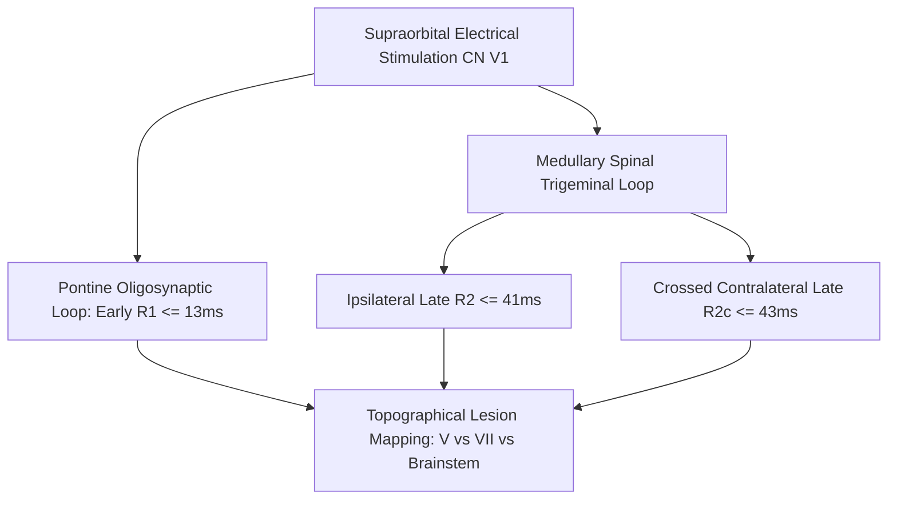

# Somatosensory Trigeminal Blink Reflex (R1/R2) Skill

[](LICENSE)
[](https://www.python.org/)
[](https://openclaw.org/)
[](https://alphapark.ai/)
[](https://modelcontextprotocol.io/)

Trigemino-Facial Blink Reflex ($R_1$, $R_2$, $R_{2c}$) Electrophysiological Analyzer for brainstem circuitry and cranial nerve integrity.



## Features
- **Zero PIP Dependencies**: Implemented strictly with Python Standard Library (`math`, `json`, `sys`, `typing`).
- **Anatomical Differential**: Disentangles afferent sensory, efferent motor, and central brainstem delays.
- **Bilateral Crossed Pathway Tracking**: Compares ipsilateral and contralateral reflex arcs.
- **Dual Architecture**: Native Python import and Model Context Protocol (MCP) JSON-RPC 2.0 stdio server.

## Quickstart
```bash
python example_usage.py
```

## License
Apache-2.0
